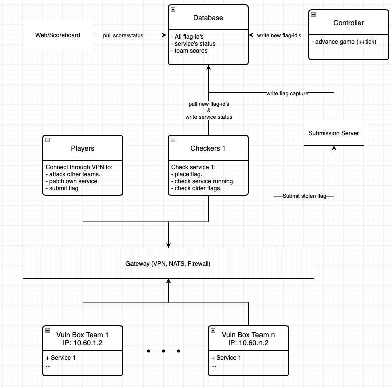

# GIFaway Local A/D Range

## How the game works

The diagram at the top shows the **network** — who can reach whom. This one shows the **game logic** — how a flag travels from the gameserver, into a team's service, out through an attacker, and back to the scoreboard as points.



At the center sits a single **Database**; every gameserver component coordinates through it instead of calling the others directly.

- **Controller** — the clock. Each tick it writes fresh flags (and their flag IDs) into the database and advances the game.
- **Checkers** (one per service) — pull the new flag IDs from the database, place each tick's flag into every team's vulnbox, confirm the service still works, and write the status (`OK` / `DOWN` / `FAULTY`) back.
- **Vuln boxes** — each team's copy of the service, at `10.60.<team>.2`. Teams patch their own; everyone attacks the others'.
- **Players** — connect over the VPN to attack other teams' vulnboxes, patch their own, and submit stolen flags.
- **Submission server** — receives stolen flags from players and records a *capture* in the database. It reads the player's real VPN address to credit the right team.
- **Web / Scoreboard** — reads scores and status from the database for display, and publishes the public flag IDs to players as `teams.json`.
- **Gateway** — the router between the zones below. It also NATs attack/checker traffic (so a vulnbox cannot tell the checker from an attacker) and firewalls players away from the database.

### Following one flag

1. The **Controller** writes a new flag to the **Database**.
2. A **Checker** reads it and places it inside every team's **vulnbox**, then records the service status.
3. An attacking **Player** reads the target's flag ID from `teams.json`, exploits that vulnbox, and steals the flag.
4. The player sends it to the **Submission server**, which records a capture in the **Database**.
5. The next tick, the **Controller** reads the captures and statuses and updates the scores.
6. The **Web / Scoreboard** reads those scores from the **Database** and shows them.

### What actually crosses the Gateway

The Gateway is a router, not a central bus — traffic passes through it only when it moves between zones. There are three:

1. **Player zone** — the VPN side (`10.66.x` / `10.80.x`).
2. **Gameserver zone** — `infra` (`10.60.0.x`): Controller, Checkers, Submission, Web, Database.
3. **Team zones** — each vulnbox's network (`10.60.<team>.x`) plus its own sealed database.

Only cross-zone trips use the Gateway: player -> vulnbox (attack, NAT'd), player -> submission/web (submit a flag, read `teams.json`; not NAT'd), and checker -> vulnbox (place/check, NAT'd). Everything inside one zone — every gameserver component talking to the Database, and each vulnbox talking to its own database — goes direct and never touches the Gateway.


---

## Prerequisites

- **Docker Desktop for Mac** (with Compose v2 and Buildx, which are the defaults).
- The three source folders, referenced by absolute path in `.env`:
  - your `ctf-gameserver` checkout,
  - GIFaway's `dist/`, `checkers/`, and `exploits/`.
- The GIFaway checker base image is **not** used here — we run the checkers under the real Checker
  Master instead, so you do **not** need the private `registry.w0y.at` login.

## Quick start

```bash
cd "Example Services/GIFaway/range"   # wherever this folder lives
cp .env.example .env                  # then edit the paths to match your Mac
make up                               # generates WireGuard keys, builds, starts everything
make doctor                           # sanity-check every layer
make scoreboard                       # opens http://localhost:8000/competition/scoreboard
```

`make up` does three things: generate WireGuard keys/configs (`make keys`), bring up the core
(gameserver + vulnboxes + gateway), and start the two VPN players. First build takes a few minutes.

### Bring it up in layers (recommended the first time)

```bash
make keys      # WireGuard keys + configs  -> ./wireguard/
make core      # gameserver + 3 vulnboxes + gateway (no players yet)
make doctor    # confirm checker -> vulnbox works and the scoreboard is live
make players   # add the two VPN attacker machines
make doctor    # confirm VPN reachability and that players can't reach the DB
```

---

## Watch the game

- **Scoreboard:** http://localhost:8000/competition/scoreboard
- **Service status:** http://localhost:8000/competition/service-status
- **Admin (change tick length, times, services):** http://localhost:8000/admin  (user `admin`, password from `.env`)
- **Flag IDs attackers can see:** `make teams-json`
- **Logs:** `make logs`, or e.g. `docker compose logs -f checker1 controller`

The controller starts at tick 0 immediately and advances every `SIM_TICK_DURATION` seconds (60 by
default). Each tick the checkers place a fresh flag on every vulnbox, verify the service, and
retrieve the last few flags — you'll see `OK` / `DOWN` / `FAULTY` in the checker logs and on the
status page.

## Run an attack (the exploit → replay loop)

Players are competitor laptops already connected over WireGuard. Pick an exploit from GIFaway's
`exploits/` folder and a target team, and read the target's flag ID from `teams.json`:

```bash
make teams-json                        # find the flag_id for the service + team you're attacking

# team1's player attacks team2's vulnbox (10.60.2.2):
make attack PLAYER=player1 TEAM=2 EXPLOIT=exploit1_store1_sql_exp.py FLAGID=<flagid>

# or drop into a player shell and work interactively:
docker compose exec player1 bash
#   python3 /exploits/exploit1_store1_sql_exp.py 10.60.2.2 <flagid>
```

When an exploit prints a flag, submit it (this is what scores attack points). From a player:

```bash
docker compose exec player1 bash -c 'echo "<FLAG>" | nc 10.60.0.12 6666'
```

The submission server sees the player's real `10.66.N.100` address and credits the right team. The
`NOP` box (`10.60.99.2`) is a safe practice target that nobody patches.

## Patch a vulnbox (defense)

A vulnbox is just the GIFaway container. GIFaway ships patches in its `patches/` folder. To defend
`team1`, rebuild its backend from patched source:

```bash
# Apply a patch to the GIFaway source, then rebuild just that team's vulnbox:
docker compose up -d --build team1-backend
```

Re-run the attacker's exploit — it should now fail — while the checker keeps the service `OK`. That
before/after is the whole game in one move. (In this sim all teams build from the same GIFaway
source; to let teams patch independently, give each a copy of the source and point its
`team*-backend` build context at that copy.)

## Connect your own Mac as a player (optional)

`make keys` also wrote `wireguard/laptop.conf` (net number 3). Import it into the **WireGuard** macOS
app and activate it — you'll get `10.66.3.100` and can browse a vulnbox or submit flags from your
host. If the tunnel won't connect, set its `Endpoint` to your Mac's LAN IP instead of `127.0.0.1`
and regenerate with `./scripts/gen-wg.sh <your-LAN-IP>`.

---

## How this maps to a real competition

| Real event | Here |
|---|---|
| Teams' laptops on VPN | `player1` / `player2` containers (and your Mac) over WireGuard |
| VPN gateway: routing, NAT, firewall | the `gateway` container |
| Checker traffic indistinguishable from teams | gateway NATs checker→vulnbox to `10.60.N.254` |
| Submission identifies team by source IP | players keep `10.66.N.x`; `CTF_TEAMREGEX` maps it |
| Vulnboxes per team | `team1/2/nop-backend` at `10.60.N.2:10067` |
| Teams can't reach the gameserver DB | gateway drops player→`gs-postgres`; infra is separate |
| Gameserver (web/controller/submission/checkers/DB) | the `infra` network |

The only thing not faithfully reproduced is physical multi-host distribution — everything runs as
containers on one Mac. The addressing, routing, NAT, and the gameserver are the same as you'd deploy
for real.

## Compatibility note (worth knowing before you host)

The GIFaway checkers call `checkerlib.get_flagid(tick)`, but your `ctf-gameserver` checkerlib does
**not** define it and the Checker Master has no `GETFLAGID` action. The gameserver image adds a small
shim (in the image only, not your source): `set_flagid` also records the id in checker **state**
keyed by tick, and `get_flagid` reads it back — using the `STORE`/`LOAD` the Master already supports.
Before a real event you'll want to either upstream a proper `get_flagid` into your gameserver or keep
this shim. It's in `gameserver/Dockerfile`.

## If something doesn't work

This bundle was written from a careful read of your gameserver's source, but it has **not** been run
end-to-end on your Mac yet (I can't drive Docker there from here). The gameserver + services + checker
core is conventional and should come up cleanly; the **WireGuard layer is the most likely to need a
small tweak** on first run. Bring the core up first (`make core` + `make doctor`) — that already
exercises networking, the gameserver, scoring, and the services together. Then add players.

Common things to check:
- **`make core` but checker can't reach a vulnbox:** the vulnbox may still be building/starting
  (`docker compose logs -f team1-backend`), or GIFaway's backend isn't listening on `10067`.
- **Scoreboard empty:** give it one or two ticks; check `docker compose logs -f controller checker1`.
- **WireGuard won't hand off (`make doctor` VPN line fails):** Docker Desktop's kernel usually has
  WireGuard built in; if not, the gateway falls back poorly — tell me and I'll switch it to the
  userspace `wireguard-go` implementation.
- **`additional_contexts` / build error:** you're on an old Docker; update Docker Desktop (Buildx).

Paste me the failing `make doctor` output or the relevant `docker compose logs`, and I'll fix the
exact spot.

## File map

```
range/
  .env.example            # paths + secrets; copy to .env
  docker-compose.yml       # the whole range
  Makefile                 # make up / core / players / doctor / attack / down / clean
  gameserver/              # one image, 5 roles (web, controller, submission, checker, init)
    Dockerfile             #   builds from YOUR ctf-gameserver source + get_flagid shim
    entrypoint.sh          #   role dispatcher + default-route-via-gateway
    sim_settings.py        #   Django settings for the sim (points at sim Postgres)
    seed.py                #   creates the game, 2 services, team1/team2/nop
    checker-wrapper.sh     #   runs a checker with the right cwd under the Master
  gateway/                 # WireGuard + router + NAT + firewall
  player/                  # a competitor laptop on the VPN
  scripts/
    gen-wg.sh              # generate WireGuard keys + configs
    doctor.sh              # layer-by-layer connectivity check
  wireguard/               # generated configs (after `make keys`)
```
